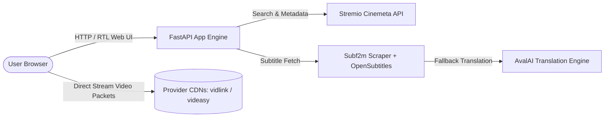

# Fistream (فی‌استریم) 🎬

> Lightweight, high-performance Persian media streaming interface built with **FastAPI**, **Cinemeta**, and an automated **AI-powered subtitle translation pipeline**.

[](https://python.org)
[](https://fastapi.tiangolo.com)
[](docs)
[](LICENSE)

---

## ⚡ Highlights

- 🍿 **Zero-Key Catalog Integration:** Integrates Stremio's Cinemeta protocol for real-time movie/series discovery, high-res posters, and metadata without requiring third-party API keys.
- 🎯 **Multi-Provider Fallback:** Dynamic player embed fallback across high-speed provider CDNs (`vidlink.pro`, `videasy`, `vidsrc.su`, `2embed`) with zero host bandwidth consumption.
- 🌐 **Intelligent Subtitle Pipeline:**
  1. Automated lookup & scraping from primary Persian subtitle archives (`subf2m`).
  2. Fallback to OpenSubtitles / English VTT with chunked **LLM translation** via AvalAI.
  3. In-memory and disk-cached VTT normalization and sync adjustments.
- 📱 **Persian-First Responsive UI:** Server-rendered Jinja2 templates styled with full RTL support, dark mode, keyboard player navigation, and mobile touch controls.

---

## 🏗️ Architecture



> **Bandwidth Efficiency:** Video stream packets travel directly between the client browser and the provider CDNs. The backend server only routes lightweight HTML metadata, search queries, and small parsed WebVTT subtitle files.

---

## 🚀 Quick Start

### 1. Requirements
- Python 3.10+
- `pip` or `uv`

### 2. Installation
```bash
git clone https://github.com/farzanni/persian-stream.git
cd persian-stream/site
python3 -m venv .venv
source .venv/bin/activate
pip install -r requirements.txt
```

### 3. Run Locally
```bash
uvicorn app:app --reload --host 127.0.0.1 --port 8000
```
Visit `http://localhost:8000` to browse movies and stream.

---

## 🛠️ Configuration

| Variable | Required | Description |
|---|---|---|
| `HERMES_CUSTOM_API_AVALAI_IR_API_KEY` | Optional | AvalAI API key used for on-the-fly AI translation of missing subtitles |
| `PORT` | Optional | Server port (default: `8000`) |

---

## 📜 Deployment

For production deployment instructions using `systemd` and `nginx` reverse proxy, see [`DEPLOY.md`](DEPLOY.md).

---

## ⚖️ License
Released under the [MIT License](LICENSE).
